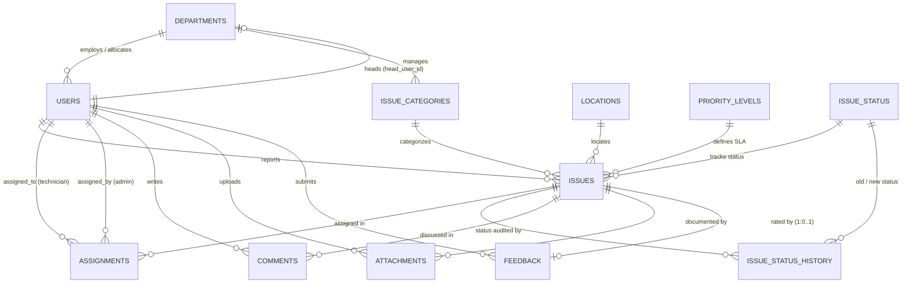

# Smart Campus Issue Management System — Database Design Document

## 1. System Overview
The **AI-Powered Smart Campus Issue Management System** is built on a 3NF-compliant relational database running MySQL 8.0 (InnoDB engine). It centralizes campus facility complaint logging, automated SLA monitoring, intelligent technician dispatching, and resolution auditing across 12 core tables.

---

## 2. Entity-Relationship (ER) Diagram

---

## 3. Core Table Specifications (12 Tables)

### Table 1: `departments`
- **Purpose**: Operational & academic units responsible for resolving campus issues.
- **Columns**:
  - `department_id` (INT, PK, AUTO_INCREMENT)
  - `department_name` (VARCHAR(100), UNIQUE, NOT NULL)
  - `head_user_id` (INT, FK -> `users.user_id`, NULLABLE, ON UPDATE CASCADE ON DELETE SET NULL)
  - `created_at` (TIMESTAMP, NOT NULL, DEFAULT CURRENT_TIMESTAMP)
- **Relationships**:
  - 1:N with `users` (department staff/technicians).
  - 1:N with `issue_categories` (`default_department_id`).
  - 1:1 optional head reference with `users` (resolved via ALTER TABLE after `users` table creation).

### Table 2: `locations`
- **Purpose**: Physical campus infrastructure reference.
- **Columns**:
  - `location_id` (INT, PK, AUTO_INCREMENT)
  - `building_name` (VARCHAR(100), NOT NULL)
  - `floor` (INT, NOT NULL)
  - `room_number` (VARCHAR(50), NOT NULL)
  - `location_type` (ENUM('hostel', 'classroom', 'lab', 'library', 'canteen', 'ground', 'other'), NOT NULL)
  - `created_at` (TIMESTAMP, NOT NULL, DEFAULT CURRENT_TIMESTAMP)
- **Constraints**:
  - UNIQUE(`building_name`, `floor`, `room_number`) prevents duplicate location records.

### Table 3: `issue_categories`
- **Purpose**: Classifications of facility maintenance requests with mapped default department.
- **Columns**:
  - `category_id` (INT, PK, AUTO_INCREMENT)
  - `category_name` (VARCHAR(100), UNIQUE, NOT NULL)
  - `description` (TEXT, NULLABLE)
  - `default_department_id` (INT, FK -> `departments.department_id`, NOT NULL, ON DELETE RESTRICT)
  - `created_at` (TIMESTAMP, NOT NULL, DEFAULT CURRENT_TIMESTAMP)

### Table 4: `priority_levels`
- **Purpose**: SLA targets and urgency thresholds.
- **Columns**:
  - `priority_id` (INT, PK, AUTO_INCREMENT)
  - `level_name` (VARCHAR(50), UNIQUE, NOT NULL)
  - `sla_hours` (INT, NOT NULL, CHECK(`sla_hours` > 0))
  - `created_at` (TIMESTAMP, NOT NULL, DEFAULT CURRENT_TIMESTAMP)

### Table 5: `issue_status`
- **Purpose**: Lookup master defining valid lifecycle states.
- **Columns**:
  - `status_id` (INT, PK, AUTO_INCREMENT)
  - `status_name` (VARCHAR(50), UNIQUE, NOT NULL: `open`, `assigned`, `in_progress`, `resolved`, `closed`, `rejected`)
  - `description` (VARCHAR(255), NULLABLE)

### Table 6: `users`
- **Purpose**: Campus actors (Students, Staff, Administrators, Technicians).
- **Columns**:
  - `user_id` (INT, PK, AUTO_INCREMENT)
  - `name` (VARCHAR(100), NOT NULL)
  - `email` (VARCHAR(150), UNIQUE, NOT NULL)
  - `password_hash` (VARCHAR(255), NOT NULL — bcrypt salt + hash)
  - `phone` (VARCHAR(20), NULLABLE)
  - `role` (ENUM('student', 'staff', 'admin', 'technician'), NOT NULL)
  - `department_id` (INT, FK -> `departments.department_id`, NULLABLE, ON DELETE SET NULL)
  - `is_active` (BOOLEAN, NOT NULL, DEFAULT TRUE)
  - `created_at` (TIMESTAMP, NOT NULL, DEFAULT CURRENT_TIMESTAMP)

### Table 7: `issues`
- **Purpose**: Primary complaint ticket record.
- **Columns**:
  - `issue_id` (INT, PK, AUTO_INCREMENT)
  - `title` (VARCHAR(255), NOT NULL)
  - `description` (TEXT, NOT NULL)
  - `reported_by` (INT, FK -> `users.user_id`, NOT NULL, ON DELETE RESTRICT)
  - `category_id` (INT, FK -> `issue_categories.category_id`, NOT NULL, ON DELETE RESTRICT)
  - `location_id` (INT, FK -> `locations.location_id`, NOT NULL, ON DELETE RESTRICT)
  - `priority_id` (INT, FK -> `priority_levels.priority_id`, NOT NULL, ON DELETE RESTRICT)
  - `status_id` (INT, FK -> `issue_status.status_id`, NOT NULL, ON DELETE RESTRICT)
  - `created_at` (TIMESTAMP, NOT NULL, DEFAULT CURRENT_TIMESTAMP)
  - `updated_at` (TIMESTAMP, NOT NULL, DEFAULT CURRENT_TIMESTAMP ON UPDATE CURRENT_TIMESTAMP)
  - `resolved_at` (TIMESTAMP, NULLABLE, DEFAULT NULL)

### Table 8: `assignments`
- **Purpose**: Dispatching technicians to issues.
- **Columns**:
  - `assignment_id` (INT, PK, AUTO_INCREMENT)
  - `issue_id` (INT, FK -> `issues.issue_id`, NOT NULL, ON DELETE RESTRICT)
  - `assigned_to` (INT, FK -> `users.user_id`, NOT NULL, ON DELETE RESTRICT)
  - `assigned_by` (INT, FK -> `users.user_id`, NOT NULL, ON DELETE RESTRICT)
  - `assigned_at` (TIMESTAMP, NOT NULL, DEFAULT CURRENT_TIMESTAMP)
  - `expected_completion` (TIMESTAMP, NULLABLE)
  - `completed_at` (TIMESTAMP, NULLABLE)

### Table 9: `issue_status_history`
- **Purpose**: Full audit trail of ticket lifecycle transitions.
- **Columns**:
  - `history_id` (INT, PK, AUTO_INCREMENT)
  - `issue_id` (INT, FK -> `issues.issue_id`, NOT NULL, ON DELETE CASCADE)
  - `old_status_id` (INT, FK -> `issue_status.status_id`, NULLABLE, ON DELETE RESTRICT)
  - `new_status_id` (INT, FK -> `issue_status.status_id`, NOT NULL, ON DELETE RESTRICT)
  - `changed_by` (INT, FK -> `users.user_id`, NULLABLE, ON DELETE SET NULL)
  - `changed_at` (TIMESTAMP, NOT NULL, DEFAULT CURRENT_TIMESTAMP)
  - `remarks` (TEXT, NULLABLE)

### Table 10: `comments`
- **Purpose**: Communication thread between student, admin, and technician.
- **Columns**:
  - `comment_id` (INT, PK, AUTO_INCREMENT)
  - `issue_id` (INT, FK -> `issues.issue_id`, NOT NULL, ON DELETE CASCADE)
  - `user_id` (INT, FK -> `users.user_id`, NOT NULL, ON DELETE RESTRICT)
  - `comment_text` (TEXT, NOT NULL)
  - `created_at` (TIMESTAMP, NOT NULL, DEFAULT CURRENT_TIMESTAMP)

### Table 11: `attachments`
- **Purpose**: Evidence photos or documents attached to an issue.
- **Columns**:
  - `attachment_id` (INT, PK, AUTO_INCREMENT)
  - `issue_id` (INT, FK -> `issues.issue_id`, NOT NULL, ON DELETE CASCADE)
  - `file_path` (VARCHAR(255), NOT NULL)
  - `file_type` (VARCHAR(50), NOT NULL)
  - `uploaded_by` (INT, FK -> `users.user_id`, NOT NULL, ON DELETE RESTRICT)
  - `uploaded_at` (TIMESTAMP, NOT NULL, DEFAULT CURRENT_TIMESTAMP)

### Table 12: `feedback`
- **Purpose**: Post-resolution reporter satisfaction rating.
- **Columns**:
  - `feedback_id` (INT, PK, AUTO_INCREMENT)
  - `issue_id` (INT, FK -> `issues.issue_id`, NOT NULL, UNIQUE, ON DELETE CASCADE)
  - `user_id` (INT, FK -> `users.user_id`, NOT NULL, ON DELETE RESTRICT)
  - `rating` (INT, NOT NULL, CHECK(`rating` >= 1 AND `rating` <= 5))
  - `feedback_text` (TEXT, NULLABLE)
  - `submitted_at` (TIMESTAMP, NOT NULL, DEFAULT CURRENT_TIMESTAMP)

---

## 4. Referential Integrity & Performance Indexes

| Table | Index Name | Indexed Column(s) | Primary Purpose |
|---|---|---|---|
| `issues` | `idx_issues_status` | `status_id` | Status dashboard filtering & count queries |
| `issues` | `idx_issues_category` | `category_id` | Category analytics & department aggregation |
| `issues` | `idx_issues_reported_by` | `reported_by` | Student "My Issues" portal lookup |
| `issues` | `idx_issues_created_at` | `created_at` | Overdue SLA calculations & trend analysis |
| `issues` | `idx_issues_location` | `location_id` | Hotspot building analysis |
| `issues` | `idx_issues_priority` | `priority_id` | SLA calculation joins |
| `assignments` | `idx_assignments_assigned_to` | `assigned_to` | Technician "My Tasks" & active workload view |
| `assignments` | `idx_assignments_issue_id` | `issue_id` | Task lookup per issue ticket |
| `issue_status_history` | `idx_issue_status_history_issue_id` | `issue_id` | Status timeline recreation in UI |
| `users` | `idx_users_role` | `role` | Role-based queries (e.g., finding technicians) |
| `users` | `idx_users_department` | `department_id` | Departmental technician workload calculation |
